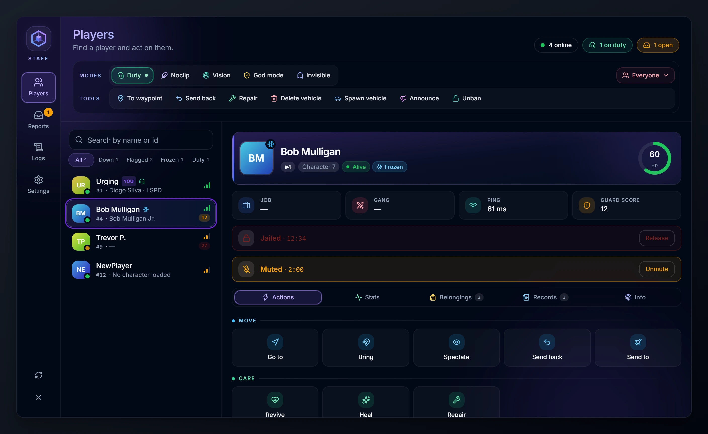
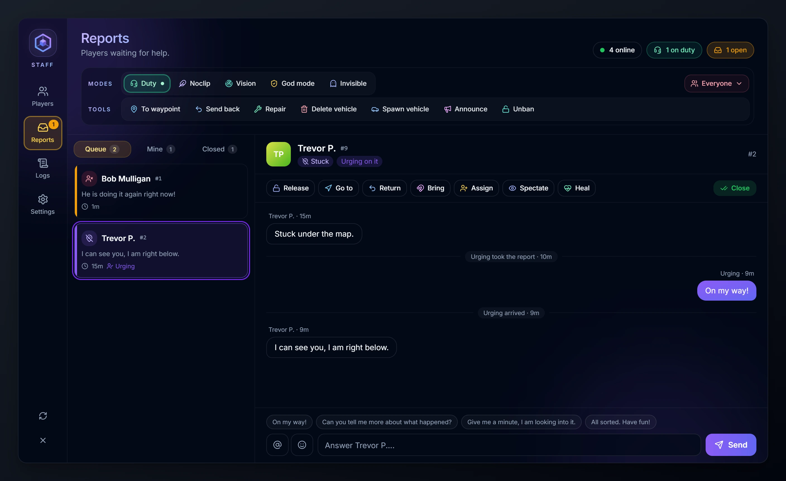
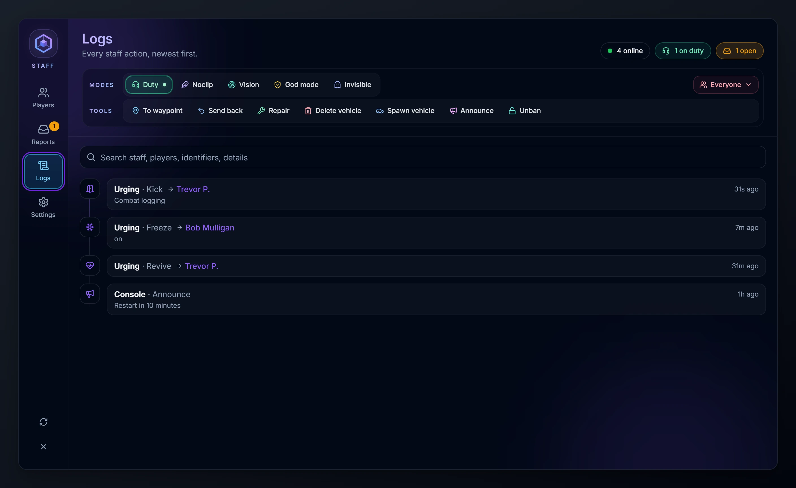
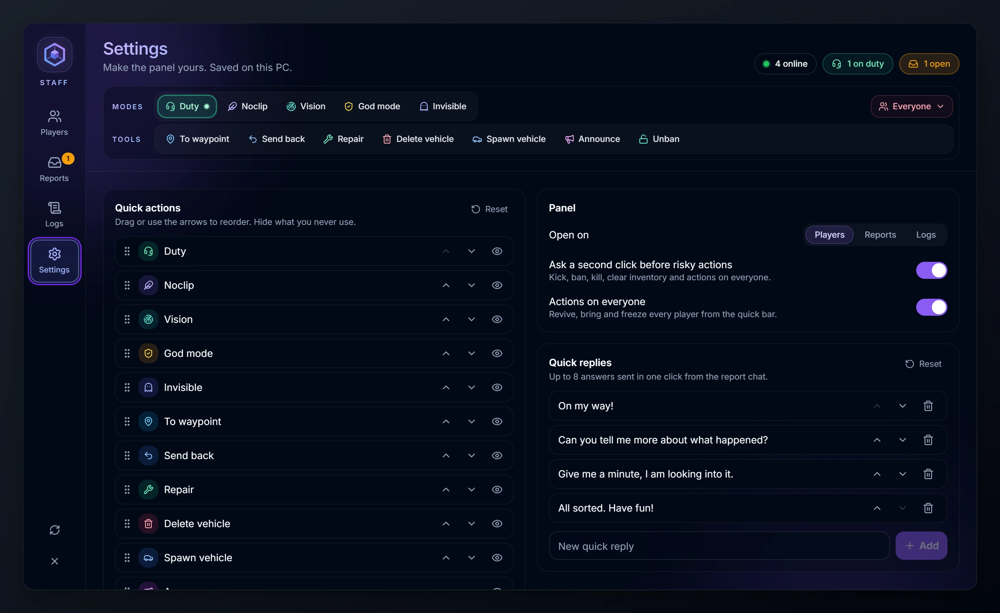
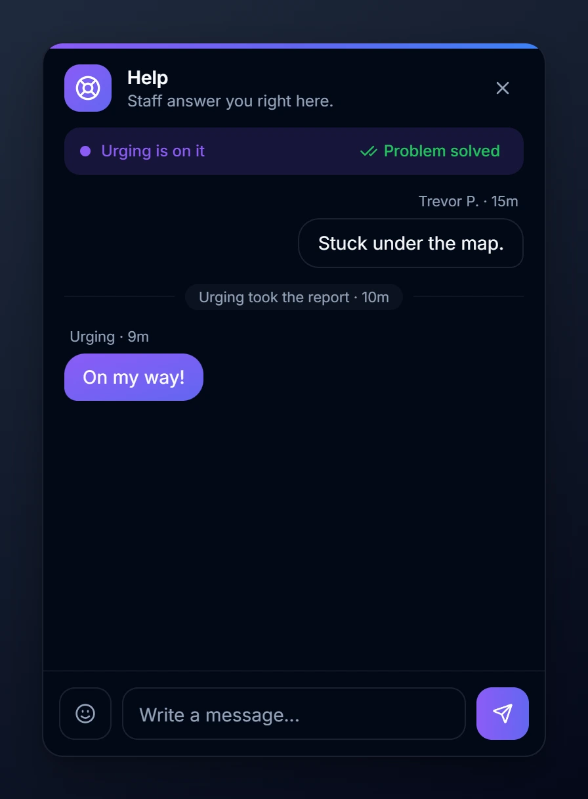

<div align="center">

# ⬢ ug-admin

**Staff tools for UgCore. 34 commands, a cinematic noclip, spectate, vision, reports, an audit log and a live panel.**

[](https://ugcore.urging.ch/ug-admin/introduction)
[](https://github.com/ugcore-project/ug-admin/actions/workflows/ci.yml)
[](LICENSE)
[](https://discord.gg/pCJUcyVw5X)

[**Documentation**](https://ugcore.urging.ch/ug-admin/introduction) · [**Installation**](https://ugcore.urging.ch/ug-admin/installation) · [**Commands**](https://ugcore.urging.ch/ug-admin/commands) · [**Configuration**](https://ugcore.urging.ch/ug-admin/configuration) · [**API**](https://ugcore.urging.ch/ug-admin/api)


</div>

---

Every staff action runs through one server pipeline, whether it comes from chat, the console or the panel: access by
ug-core group, rank checks so nobody acts on a higher rank, validated arguments, an audit row and a Discord log.

## Features

- 🚁 **Drone noclip.** The camera rises off the gameplay camera, still looking where you looked, and flies with
  smoothed acceleration, a FOV kick at speed and a fine-grained wheel speed. The crosshair targets what it points at
  (model, network id, plate, owner) in a card, with a key legend that lights up the keys that apply. Click to land there, `Delete` removes the entity, `G` freezes a player, `F`
  boards a vehicle, `C` copies a `vector4`. Leaving dives the camera back onto the ped.
- 👁️ **Spectate.** A fade and a satellite swoop onto the target, then an orbit camera with zoom and a live card
  (health, armor). Arrows switch players, skipping ranks you may not watch. It joins the target's routing bucket and
  brings you back where you were.
- 📡 **Vision.** Every player on the map with a heading blip, plus name tags over heads, from a server radar sent only
  to staff with vision on.
- 🛡️ **Modes.** God mode, invisible and frozen players, owned by the server through statebags and enforced every frame.
- 📣 **Big messages.** Announcements and warnings show as GTA shards on screen.
- 🆘 **Reports with a live chat.** `/report` opens a help window: the player picks a category (question, player,
  bug, stuck, other), can name the player they report, and then chats with staff in it. Staff work from a desk in the
  panel: queue, their own reports and recently closed ones, unread markers, quick answers, and one-click **Go to** and
  **Return**, **Bring** and **Send back**, spectate and heal. Staff hand a report to someone on duty from a staff
  list searchable by player or character name, and ping each other in the chat with `@`: only the pinged staff
  member is notified, of that line only, on duty or not. Staff answers pop up for the player even with the window
  closed. Staff close with an optional last message, and the player rates the help from 1 to 5. Only staff on
  `/duty` get report alerts and take reports; going off duty puts theirs back in the queue, and a player who reports
  while nobody is on duty is told so.
- 🧾 **Audit log.** Every action in `ug_admin_log`, searchable from the panel, and posted to Discord when a webhook is set.
- 🔒 **Jail and mute.** `/jail` sends a player to a configured spot and pulls them back when they wander off. `/mute`
  blocks chat and `/report`. Both count down only while the player is online, survive reconnects and end on their own.
- 📇 **History and notes.** Each player's details list every staff action taken on them, and private staff notes.
- 🎚️ **Live control.** Sliders for health, armor and every need, exact balances, and items removed slot by slot.
- 📍 **Send to.** Places from config, or your own waypoint. Private messages show big on one player's screen.
- 👥 **Everyone at once.** Revive every downed player, bring everyone around you, freeze everyone you outrank.
- 🖥️ **Panel** (`F10` or `/admin`). Searchable player list, details (live stats, accounts, inventory, job, gang,
  groups, history, notes, identifiers to copy, Guard score), every action with forms filled from the server catalog,
  quick self and bulk actions, reports and logs. Destructive actions ask for a second click.

## Preview

| Players | Report desk |
| :---: | :---: |
|  |  |
| **Audit log** | **Settings** |
|  |  |

| Noclip targeting | Player report window |
| :---: | :---: |
|  |  |

## Commands

`[id]` is optional and defaults to yourself. Each command is limited to its group in `access`. See
[Commands](https://ugcore.urging.ch/ug-admin/commands) for which ones need you to outrank the target, and [Reports](https://ugcore.urging.ch/ug-admin/reports) for the
desk.

| Command | Does | Default group |
| --- | --- | --- |
| `/admin` | Open the panel | moderator |
| `/noclip` | Drone noclip | moderator |
| `/vision` | Players on the map and name tags | moderator |
| `/god`, `/invisible` | Toggle the mode | admin |
| `/tpm` | Teleport to the waypoint | moderator |
| `/tp x y [z]` | Teleport to coordinates, ground height without `z` | moderator |
| `/back [id]` | Return to where you were before the last teleport | moderator |
| `/goto id`, `/bring id` | Teleport to a player, or bring them | moderator |
| `/spectate [id]` | Watch a player. Without an id, stop | moderator |
| `/revive [id]` | Bring back a downed or dead player with full health and needs | moderator |
| `/heal [id]` | Restore health and needs, clear injuries. Revives when down | moderator |
| `/kill id` | Kill a player | admin |
| `/freeze id` | Freeze or unfreeze | moderator |
| `/warn id reason` | Big warning on their screen | moderator |
| `/kick id [reason]` | Kick | moderator |
| `/ban id duration reason` | Ban for `30m`, `12h`, `7d`, `2w` or `perm` | admin |
| `/unban identifier` | Lift every ban of an identifier | admin |
| `/dm id text` | Private message on one player's screen | moderator |
| `/sendto id place` | Send to a place from `locations`, or `waypoint` for yours | moderator |
| `/jail id minutes [reason]`, `/unjail id` | Jail time counts while online and survives reconnects | moderator |
| `/mute id minutes [reason]`, `/unmute id` | Block chat and `/report` | moderator |
| `/note id text` | Private staff note, shown in the panel | moderator |
| `/delnote number` | Delete a note | admin |
| `/setstats id [health] [armor]` | Health 101 to 200, armor 0 to 100 | admin |
| `/setneed id need value` | One need, 0 to 100 | admin |
| `/setmoney id account amount` | Exact balance, written to the ledger | admin |
| `/removeitem id slot [count]` | Remove some or all of one slot | admin |
| `/reviveall` | Revive every downed or dead player | admin |
| `/bringall [radius]` | Bring everyone you outrank, or those within radius | admin |
| `/freezeall` | Freeze everyone you outrank, or free them all | admin |
| `/givemoney id account amount` | Add money, or remove it with a negative amount | admin |
| `/setjob id job [grade]`, `/setgang id gang [grade]` | Set a job or gang | admin |
| `/giveitem id item [count]` | Give an item | admin |
| `/clearinv id`, `/inventory id` | Empty or open a player's inventory | admin |
| `/setgroup id group`, `/removegroup id group` | Staff groups, below your own rank only | founder |
| `/car model` | Spawn a vehicle and seat you in it, replacing your last one | admin |
| `/dv [radius]` | Delete your vehicle, or empty vehicles around you | moderator |
| `/fix [id]` | Repair a vehicle | moderator |
| `/delentity netId` | Delete an entity, never a player | admin |
| `/announce text` | Message to everyone | admin |
| `/duty` | Go on or off duty. On duty: report alerts and taking reports. Off duty releases your reports | moderator |
| `/reports id op [text]` | Handle a report. `op`: `claim`, `release`, `reply`, `goto`, `return`, `bring`, `sendback`, `close`, `assign` (text is the staff id). `@id` in a reply pings that staff member | moderator |
| `/report [message]` | Ask staff for help. A second message joins the chat. Without one, opens the window | everyone |

Commands also run from the server console, except the ones that need a ped.

## Noclip and spectate keys

See [Noclip and spectate](https://ugcore.urging.ch/ug-admin/noclip).

| Noclip | | Spectate | |
| --- | --- | --- | --- |
| `WASD`, mouse | Fly, look | Mouse | Orbit |
| `Space` or `Q`, `Ctrl` or `E` | Up, down | Wheel | Zoom |
| Wheel | Speed, 20% per notch | `←`, `→` | Previous, next player |
| `Shift`, `Alt` | Boost, slow | `Backspace` | Stop watching |
| Left click | Land at the crosshair | | |
| `Delete` | Delete the targeted entity, never a player. Map props are not networked: they are hidden for everyone until the server restarts | | |
| `G` | Freeze or unfreeze the targeted player | | |
| `F` | Board the targeted vehicle on landing | | |
| `C` | Copy coordinates | | |
| `H` | Hide or show the key legend | | |

## Requirements

- OneSync.
- [ug-core](https://github.com/ugcore-project/ug-core) 1.0.0 or newer, with the `commands` module for chat commands.
  `accounts`, `jobs`, `gangs`, `items` and `inventory` enable their actions when present.
- [ug-lib](https://github.com/ugcore-project/ug-lib) 1.0.0 or newer.
- oxmysql, for `ug_admin_log`, `ug_admin_notes` and `ug_admin_sanctions`, created on start. Without a database, the
  log keeps this session in memory, notes are off, and jail and mute end on reconnect.

## Installation

Download a release, extract it to your resources folder and start it after ug-core and ug-lib:

```cfg
ensure oxmysql
ensure ug-core
ensure ug-lib
ensure ug-admin

# Optional: post every staff action to Discord. Keep it out of config.lua: config replicates to clients.
set ug-admin:Webhook "https://discord.com/api/webhooks/..."
```

Staff are ug-core permission groups. Make yourself founder from the server console with `setgroup <id> founder`, then
promote others with `/setgroup` in game. On the first
start, `server/config.default.lua` is copied to `config.lua`. Updates never overwrite it.

The console prints `[ug-admin] v1.0.0 ready. 49 command(s), N staff online.` Staff see `[ug-admin] Staff: N action(s).`
in F8.

## Configuration

See [Configuration](https://ugcore.urging.ch/ug-admin/configuration) and [Look and feel](https://ugcore.urging.ch/ug-admin/configuration-look) for every option.

| Key | Default | Purpose |
| --- | --- | --- |
| `access` | see `server/config.default.lua` | Lowest ug-core group for each action. Higher groups inherit it. Entries merge with the defaults. |
| `keys` | `noclip = 'F2'`, `panel = 'F10'`, `vision = ''` | Default keys. Players MAY rebind them. Empty means no default. |
| `noclipSpeeds` | `{ 1.5, 15, 200 }` | Noclip speeds in m/s. The slowest and fastest bound the wheel (20% per notch), flights start at the second. |
| `radarInterval` | `1500` | Milliseconds between vision updates. |
| `maxDeleteRadius` | `50` | Largest `/dv` radius in meters. |
| `replaceSpawnedVehicle` | `true` | `/car` deletes your previous spawn. |
| `reportCooldown` | `60` | Seconds between reports of one player. |
| `maxReports` | `100` | Reports kept in memory. |
| `startOnDuty` | `false` | Staff with `/duty` start on duty when their character loads. |
| `banDurations` | `1h`, `1d`, `3d`, `7d`, `30d`, `perm` | Choices in the panel. |
| `jail` | Bolingbroke | `coords` to jail at, `radius` in meters before a prisoner is pulled back, `release` spot. |
| `locations` | hospital, police, legion, airport, sandy, paleto | `/sendto` places: `name = { label, coords }`. `waypoint` is reserved. |
| `theme` | `{}` | ug-lib theme overrides for the panel. `colors` also takes the section tones `violet`, `indigo`, `blue`, `sky`, `teal`, `emerald`, `amber`, `rose`, `fuchsia`; their lighter shades follow. |
| `layout` | see `server/config.default.lua` | `width`, `height` (rem), `rail` (`left`, `right`), `backdrop`, `glow`, `logo`, `quickBar`, `toasts` (`top`, `bottom`), `toastDuration`, `animations`, `refreshInterval`, `noclipHud`. Merges field by field. |
| `tabs` | players, reports, logs, settings | Panel tabs in order. Leave one out to hide it. |
| `noclip` | see `server/config.default.lua` | `fov`, `fovKick`, `lookSpeed`, `smoothing`, `boost`, `slow`, `liftDuration`, `diveDuration` (0 cuts), `inspect`, `outline`, `outlineColor`, `marker`. Merges field by field. |
| `spectate` | swoop from 90 m | `swoop`, `swoopHeight`, `swoopDuration`, `fade`. Merges field by field. |
| `shards` | announce, warn, message | Per kind `{ duration, color, sound? }`. A kind left out shows as a notification. |
| `invisibleAlpha` | `140` | How see-through invisible staff look to themselves. |

## Integration

See the [API](https://ugcore.urging.ch/ug-admin/api).

```lua
-- Server: every staff action, after it ran.
-- entry: { actor, actorName, action, target?, targetName?, detail, at }, identifiers and Unix seconds.
UgCore.Events.On('ug-admin:Action', function(entry) end)

-- Server: a player asked for help. report: { id, source, name, message, category, accused?, status, at, messages }.
UgCore.Events.On('ug-admin:Reported', function(report) end)

-- Server: a player rated the help on a closed report, 1 to 5. report.closedBy is the staff name.
UgCore.Events.On('ug-admin:ReportRated', function(report, rating) end)
```

## Project structure

```text
ug-admin/
├── fxmanifest.lua
├── shared/              the global, enums, argument rules
├── server/              config, staff, actions, manage, sanctions, notes, commands, panel, audit, reports, spectate, radar, world
├── client/              noclip, spectate, vision, modes, camera, panel, NUI bridge
├── locales/             en, pt
├── web/                 React panel, built to web/dist
├── tests/               Lua 5.4 tests with native mocks, never shipped
├── skills/              task guides for AI agents, never shipped
├── AGENTS.md            rules for AI agents and humans
└── CLAUDE.md            points Claude Code to AGENTS.md
```

## Development

Clone ug-core and ug-lib next to this repository: the tests and the type check read them from `../ug-core` and
`../ug-lib`, or from the `UG_CORE` and `UG_LIB` paths.

```bash
# 1. LuaLS strict check, zero problems, with ug-core, ug-lib and the CfxLua natives as libraries
lua-language-server --check . --checklevel=Information --configpath=.luarc.json

# 2. Lua tests
for suite in tests/*.lua; do [ "$suite" = tests/helpers.lua ] || lua5.4 "$suite" || exit 1; done

# 3. Manifest and license headers
lua5.4 .github/scripts/check-repository.lua
```

The page needs Node.js 20.19 or newer:

```bash
cd web
npm ci
npm run lint && npm run typecheck && npm test
npm run build && npm run budget   # web/dist, at most 400 KB gzipped
npm run dev                       # browser preview with buttons that play the showcase scenes
npm run capture                   # README images from the scenes, to .github/assets
```

### Working with AI agents

[AGENTS.md](AGENTS.md) holds the conventions and security rules every agent MUST follow. Claude Code reads it through
`CLAUDE.md`; Codex, Cursor and others read `AGENTS.md` directly. Task guides:

| Skill | For |
| --- | --- |
| [server-actions](skills/server-actions/SKILL.md) | Callbacks and net events |
| [nui-page](skills/nui-page/SKILL.md) | The page, its messages and callbacks |
| [config](skills/config/SKILL.md) | Owner config options |
| [database](skills/database/SKILL.md) | MySQL through oxmysql |
| [testing](skills/testing/SKILL.md) | Lua and web tests |
| [readme-preview](skills/readme-preview/SKILL.md) | README features and images |
| [ug-core-api](skills/ug-core-api/SKILL.md) | What ug-core and ug-lib offer |

### Releases

Releases are automated. release-please keeps a `chore: release X.Y.Z` pull request open on `main` that bumps
`version` in `fxmanifest.lua` and `CHANGELOG.md` from Conventional Commits. Merging it tags `vX.Y.Z`, builds the page
and attaches `ug-admin.zip` with only what a server runs. Every push to `dev` replaces the `dev-build` pre-release.
Merge `dev` into `main` with a merge commit, never squash. Commit subjects become the changelog: write them for owners.

## Contributing

Branch off `dev` and open a pull request to `dev`. Commits and PR titles follow
[Conventional Commits](https://www.conventionalcommits.org): lowercase imperative subject, no trailing period, 72
characters at most. Scopes: `core`, `commands`, `noclip`, `spectate`, `vision`, `reports`, `audit`, `panel`, `api`,
`nui`, `web`, `config`, `locale`, `ci`, `deps`.

Read the [contributing guide](https://github.com/ugcore-project/.github/blob/main/CONTRIBUTING.md) and the
[Code of Conduct](https://github.com/ugcore-project/.github/blob/main/CODE_OF_CONDUCT.md).

## Security

Never report a vulnerability in a public issue. [Report it privately](https://github.com/ugcore-project/ug-admin/security/advisories/new)
and read the [Security Policy](https://github.com/ugcore-project/.github/blob/main/SECURITY.md).

## License

ug-admin is free software, licensed under the [GNU General Public License v3.0](LICENSE).

Copyright (C) 2026 UgCore Framework & Contributors.
